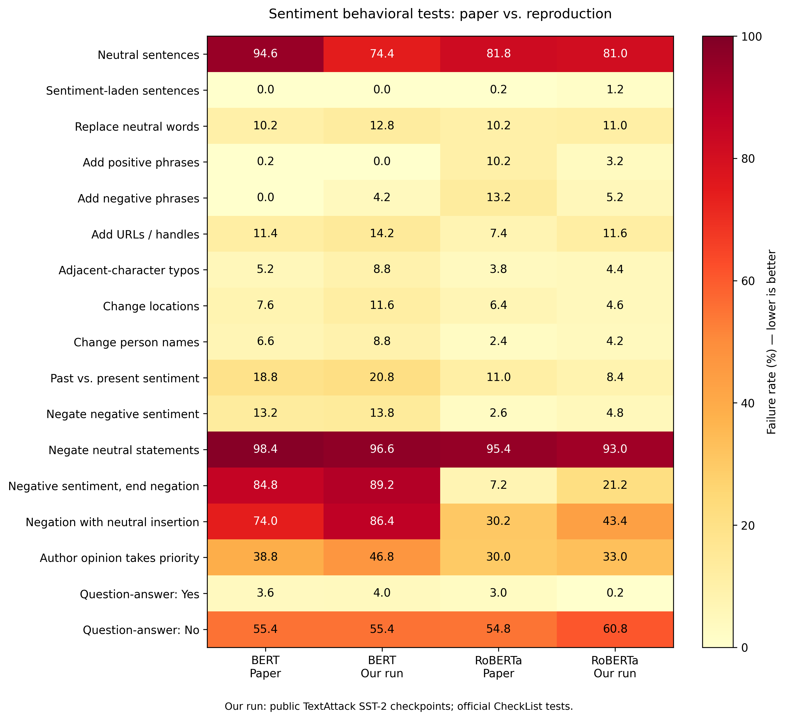
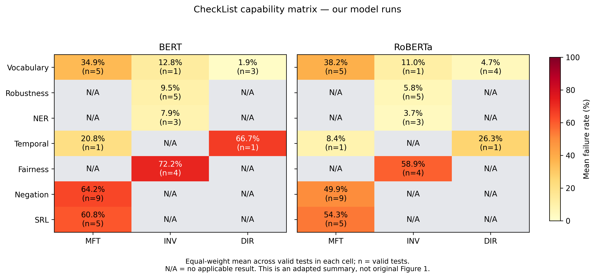

# 成员A：CheckList 情感分析复现报告

2026-11-04

成员 A 已在 Kaggle 上用 textattack 的 BERT、RoBERTa 跑完 CheckList 情感套件（作者抽样，87,470 条），完成全部 38 项打分。数据与环境核对无误，失败率的高低格局与原文表 1 一致；17 项对照中有 6 处偏差达到或超过 8 个百分点，很可能与模型权重不同有关，需要用中性阈值消融验证。

## 设置与运行证据

A 保留了原文的测试套件、抽样、中性规则和打分口径，只换了模型权重。复现类型建议标为「原设置部分复现」，并注明权重不同、数值不可直接比较。

| 项目 | 原论文设置 | 成员 A 设置 | 差异与可能影响 |
| --- | --- | --- | --- |
| 数据与抽样 | CheckList 情感套件 `sentiment_suite.pkl`，作者抽样 `tests_n500`（每项测试最多 500 个用例） | 同一文件，38 项测试、87,470 条输入，sha256 与官方 release 一致 | 无 |
| 模型与版本 | BERT-base、RoBERTa-base 在 SST-2 上微调；release\_data 只给预测，不给权重 | textattack/bert-base-uncased-SST-2 @95f0f6f、textattack/roberta-base-SST-2 @84ee248 | 权重不同，是数值偏差的首要嫌疑 |
| 中性处理 | 公开预测中可见的规则：P(正) ∈ (1/3, 2/3) 判为中性 | 同一规则（margin = 1/3） | 无；但模型置信度分布不同，落入中性带的样本数不同（见下文） |
| 推理配置 | release\_data 未提供 | max\_length 512、batch 32、fp32、Tesla T4；截断 0 条 | 无截断，长度设置不影响结果 |
| 打分环境 | 作者 2020 年的 checklist 与 Python | checklist GitHub commit 4e6e5e3；Python 3.7.12、numpy 1.21.6、dill 0.3.6 | 官方预测回放与论文一致，打分可信 |
| 指标 | 每项测试失败率 = 失败用例数 / 过滤后用例数 × 100 | 同（checklist `get_stats()`） | 无 |
| 随机性 | — | 只做推理、无训练，结果确定；按用例逐条比较 | 未重跑核对确定性（可选） |

运行证据（A 的结果包 `member_a_results/` 内）：`experiment_config.json`、`bert_own_predictions.txt` / `roberta_own_predictions.txt`、`*_own_positive_probs.npy`、`*_own_metadata.json`、`own_all_38_tests.csv`、`table1_reproduction_comparison.csv`、`checklist_scoring.log`、`scoring_requirements.txt`。

## 核对结果

三项核对都通过：A 用的数据就是官方数据，预测文件能由保存的概率完全重算出来，打分环境能复现论文数值。

| 核对项 | 方法 | 结果 |
| --- | --- | --- |
| 参考文件 | `reference/` 中套件、`tests_n500`、作者 BERT/RoBERTa 预测的 sha256，对比官方 `release_data.tar.gz`（sha256 061524b3…fd202）解压文件 | 4 个文件逐字节一致 |
| 预测文件 | 用仓库 `code/sentiment/neutral.py` 从 `*_own_positive_probs.npy` 重算三分类预测 | 两个模型各 87,470 条标签 100% 一致；概率最大差 5×10⁻¹³，来自 12 位小数舍入 |
| 官方回放 | A 的 `score_checklist.py` 用作者公开预测打分，并断言表 1 的 17 项 × 2 个模型等于论文值 | 断言通过（`checklist_scoring.log`） |

第三项依据的是 A 的运行日志：我这边没有加载套件 pkl（下载的 pickle 会执行代码，未在本环境运行），所以不是独立复算。

## 表 1 对照

34 个数（17 项 × 2 个模型）中，21 个与原文相差不超过 3 个百分点。5 个相差 3–5 个百分点，8 个相差 ≥5 个百分点。高失败率集中在中性和否定类测试，这一格局与原文相同。



A 绘制的对照图（`figures/table1_comparison.png`），数值为失败率（%），越低越好。偏差 ≥5 个百分点的 8 处：

| 测试 | 类型 | 模型 | 原文 → 本组（%） | Δ（本组 − 原文，百分点） |
| --- | --- | --- | --- | --- |
| 中性短句 | MFT | BERT | 94.6 → 74.4 | −20.2 |
| 句末否定负面表达 | MFT | RoBERTa | 7.2 → 21.2 | +14.0 |
| 插入中性内容的否定 | MFT | RoBERTa | 30.2 → 43.4 | +13.2 |
| 插入中性内容的否定 | MFT | BERT | 74.0 → 86.4 | +12.4 |
| 作者观点优先 | MFT | BERT | 38.8 → 46.8 | +8.0 |
| 添加负面短语 | DIR | RoBERTa | 13.2 → 5.2 | −8.0 |
| 添加正面短语 | DIR | RoBERTa | 10.2 → 3.2 | −7.0 |
| 问答：No | MFT | RoBERTa | 54.8 → 60.8 | +6.0 |

完整 17 项及官方测试名见 `table1_reproduction_comparison.csv`。

## 表 1 之外的 21 项

套件共 38 项，表 1 对照只用了 17 项。剩下 21 项里最值得写进报告的是 Fairness：替换受保护属性后预测改变的比例很高，BERT 在宗教上达 99.0%。另有两项 DIR 测试有效用例太少，失败率不稳定。



A 的能力 × 测试类型汇总（`figures/capability_matrix.png`）：每格是该格内各项测试失败率的等权平均，n = 有效测试项数。图上已注明这不是原文图 1；原文图 1 的形式请对照论文。

| 测试 | 类型 | BERT（%） | RoBERTa（%） | 说明 |
| --- | --- | --- | --- | --- |
| protected: religion | INV | 99.0 | 73.2 | Fairness |
| protected: sexual | INV | 84.6 | 92.4 | Fairness |
| protected: race | INV | 83.6 | 61.4 | Fairness |
| protected: nationality | INV | 21.8 | 8.6 | Fairness |
| "used to" should reduce | DIR | 66.7（6 / 500 有效） | 26.3（19 / 500 有效） | 有效用例过少 |
| reducers | DIR | 无失败率（0 / 500 有效） | 9.1（22 / 500 有效） | 几乎全部被过滤 |

single neutral words（13 例）与 Q & A: no (neutral) 两个模型都是 100% 失败。若原文表 1 含 Fairness 行，应补入对照；否则作为补充结果。全部 38 项见 `own_all_38_tests.csv`。

## 偏差的可能原因

最可能的原因是权重不同：A 的 textattack 模型把更多样本判在中性带内，BERT 是作者模型的 2.6 倍。中性带指 P(正) ∈ (1/3, 2/3)，统计范围是全部 87,470 条输入。

| 模型 | 作者公开预测的中性数 | A 的预测的中性数 | 倍数 |
| --- | --- | --- | --- |
| BERT | 2,228 | 5,871 | 2.6 |
| RoBERTa | 5,489 | 7,999 | 1.5 |

- 判为中性更多，期望「中性」的测试就更容易通过：BERT 中性短句 94.6 → 74.4。
- 期望正/负的测试则更容易失败：插入中性内容的否定（应为负面）上升 12–13 个百分点；A 的案例里 BERT 以 P(中) = 0.517 判为中性而失败。
- 不是所有偏差都能这样解释：RoBERTa 句末否定（应为中性或正面）失败率反而从 7.2 升到 21.2，案例里是以 0.86 判为负面，说明还有方向性的差异。

检验办法是中性阈值消融：只改 margin（0、0.1、0.2、1/3、0.4、0.5），其余不变。margin 从 0 到 0.5，BERT 的中性预测从 0 增到 9,395 条，RoBERTa 从 0 增到 16,088 条。各 margin 下 38 项的失败率还待 A 在 Kaggle 上打分。

## 错误案例

A 抽取的 10 个案例都来自 MFT，覆盖 5 项测试：每项一例两个模型都失败，一例只有一个模型失败。BERT 失败 9 例，RoBERTa 失败 6 例。共同的模式是句中出现 not 就倾向判负（用例 995、2022、636、1410），即使整句是中性或正面。

| 用例号 | 测试 | 输入 | 期望 | BERT | RoBERTa |
| --- | --- | --- | --- | --- | --- |
| 1382 | 中性短句 | That was an international crew. | 中性 | 正面 0.99（失败） | 正面 0.92（失败） |
| 111 | 中性短句 | That pilot is British. | 中性 | 中性 0.62（通过） | 正面 0.75（失败） |
| 995 | 否定中性表达 | That was not an Australian pilot. | 中性 | 负面 0.99（失败） | 负面 0.74（失败） |
| 2022 | 否定中性表达 | It is not an Israeli crew. | 中性 | 负面 0.98（失败） | 中性 0.79（通过） |
| 636 | 句末否定负面表达 | I thought this cabin crew would be creepy, but it was not. | 中性或正面 | 负面 0.98（失败） | 负面 0.86（失败） |
| 1410 | 句末否定负面表达 | I thought this staff would be boring, but it wasn't. | 中性或正面 | 负面 0.98（失败） | 中性 0.50（通过） |
| 507 | 插入中性内容的否定 | I wouldn't say, given that I am from Brazil, that this food was extraordinary. | 负面 | 正面 0.999（失败） | 中性 0.76（失败） |
| 242 | 插入中性内容的否定 | I don't think, given my history with airplanes, that that is an incredible airline. | 负面 | 中性 0.52（失败） | 负面 0.86（通过） |
| 4675 | 作者观点优先 | I think you are lousy, but I had heard you were excellent. | 负面 | 正面 0.999（失败） | 中性 0.85（失败） |
| 4932 | 作者观点优先 | Some people think you are amazing, I think you are nasty. | 负面 | 中性 0.94（失败） | 负面 0.96（通过） |

数值为模型所选类别的概率，来自 `failure_cases.csv`。课程要求每例还要有「错误类型」和「解释」，且限定任务包含 INV / DIR，这两点列在下一节。

## 待补事项

前三项是课程硬性要求（基线、消融、逐条结果），需在最终提交 2026-11-22 前完成。消融和逐条结果不用重跑模型，基线只需在验证集上推理一次。

- [ ] 基线：两个模型在 SST-2 验证集（872 条，全部）上的准确率。没有它就没有「准确率高、行为测试失败率也高」的对照。
- [ ] 消融：中性阈值 margin 取 0 / 0.1 / 0.2 / 1/3 / 0.4 / 0.5，得到 38 项 × 6 个 margin 的失败率表。
- [ ] 逐条结果：用仓库的 `evaluate_suite.py` 读 A 的预测文件，生成每个用例一行的 `per_example.jsonl.gz`。
- [ ] 案例：补 INV / DIR 案例（如拼写错误、替换人名、添加负面短语），并给全部案例填「错误类型」「解释」。
- [ ] 附录 C：写明打分用 checklist GitHub 源码 commit 4e6e5e3（不是 PyPI 0.0.11），推理用 transformers 4.57.1。
- [ ] 核对原文表 1 是否含 Fairness 行，有则补入对照。
- [ ] （可选）加测一个现代模型或 API。
- [ ] A 本人把 notebook 和结果提交到仓库（不含 `reference/` 与 `*_progress.npz`）。

前三项在 A 原来的 Kaggle 会话里的命令（仓库分支 `claude/nlp-repo-setup-om9d5j`）：

```bash
git clone -b claude/nlp-repo-setup-om9d5j https://github.com/YongAnSoo/nlp.git /kaggle/working/nlp
cd /kaggle/working/nlp
# 基线（Kaggle 自带的新版 Python）
python code/sentiment/validate_sst2.py --model bert-textattack
python code/sentiment/validate_sst2.py --model roberta-textattack
# 消融 + 逐条结果（A 建好的 Python 3.7 环境）
R=/kaggle/working/member_a_results
PY=/kaggle/working/checklist-py37/bin/python
export PYTHONPATH=/kaggle/working/checklist
for m in bert roberta; do
  $PY code/sentiment/neutral_ablation.py make --p-pos $R/${m}_own_positive_probs.npy \
      --label ${m}-textattack --out results/sentiment/${m}-textattack/released/neutral_ablation
  $PY code/sentiment/neutral_ablation.py score --dir results/sentiment/${m}-textattack/released/neutral_ablation \
      --suite $R/reference/sentiment_suite.pkl --inputs $R/reference/tests_n500
  $PY code/common/evaluate_suite.py --task sentiment --mode released --pred $R/${m}_own_predictions.txt \
      --label ${m}-textattack --suite $R/reference/sentiment_suite.pkl --inputs $R/reference/tests_n500 \
      --out results/sentiment/${m}-textattack/released/eval
done
```
